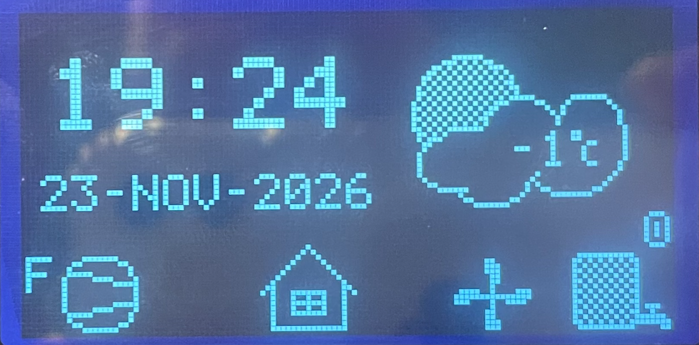
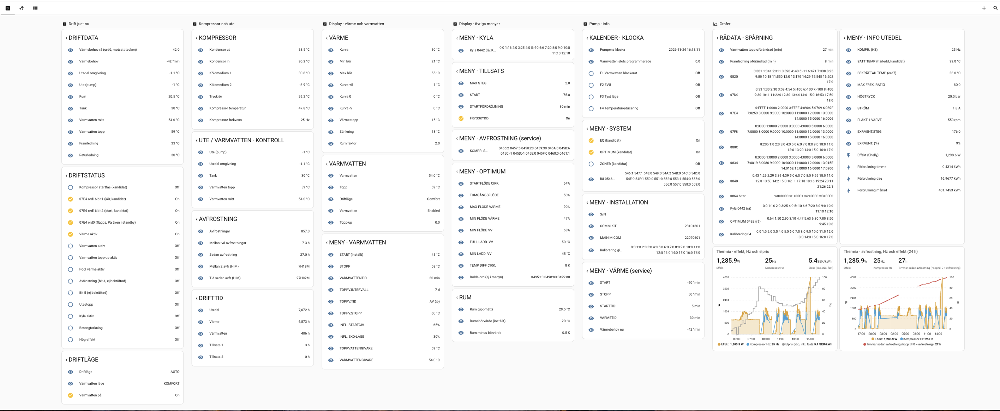
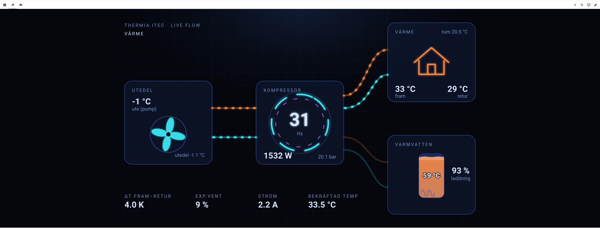

# Thermia iTec XT10: read-only DCM gateway emulation with ESPHome

A read-only emulation of the Thermia online gateway (DCM) for the **Thermia iTec XT10** air/water heat pump, running on an **ESP32-S3** with an RS485 transceiver and **ESPHome**. It lets Home Assistant read the heat pump's runtime values and menu settings locally, without the cloud and without writing anything to the pump.

> **Status: work in progress.** The ESP answers the pump's gateway handshake automatically after every power-up and then reads the pump for many hours at a time without errors. Most sensors are verified against the pump display; the rest are marked as candidates (see below). The handshake code is not published yet.

## Current status (24 November 2026)

- The ESP arms itself about 30 s after boot, with no button and no time limit. A watchdog that reboots and re-arms after a lost session is built in but has not been exercised yet.
- Start-up: 31 of 31 configuration pages are ACKed within about 75 s of the challenge, then the runtime ring. It has run since without errors, CRC failures or dropped frames; a few RESYNC events per minute are ordinary line noise. An earlier run lasted 5.7 hours the same way.
- Display menus mapped to registers and checked against the pump display: heating curve, hot water, VÄRME (service), TILLSATS, OPTIMUM, INFO UTEDEL, serial number and firmware versions, clock, operating hours and defrost counters.
- Outdoor unit values verified at standby and with the compressor running: high pressure is `0820` word 16 divided by 10 (display 20.5 bar, log 20.5 bar), expansion valve steps are word 13 (display 204 = 10 %, so percent is steps divided by 20).
- Compressor start and stop captured three times: start at heat demand -50 degree-minutes, stop at +50.
- Still open: SATT TEMP and BEKRÄFTAD TEMP on the INFO UTEDEL menu, the defrost flag and a few status bits.

## What it does

- Answers the pump's gateway challenge on slave address `0x0F` (RS485, 9600 baud, 8E1), automatically after each pump start, with no button press and no time limit.
- Acknowledges the 31 configuration pages the pump exports at start-up and the ten runtime pages that follow, and answers the `0708` mailbox. These acknowledgements are transport-level only.
- Decodes the received pages into Home Assistant sensors named like the pump's display menus (VARMVATTEN, VÄRME, TILLSATS, OPTIMUM, INFO UTEDEL, INSTALLATION, KALENDER and others).
- Includes a watchdog that reboots the ESP and re-arms it if the session with the pump is lost (built in, not yet exercised).

## What it does not do

- **No writes.** The ESP never changes a pump parameter. There are no setpoint sliders or room sensor writes, by design. Writing blind to a working heat pump can do real damage.
- No cloud, no account, no vendor app.

## Hardware

| Part | Notes |
|---|---|
| ESP32-S3 DevKitC-1 N16R8 | UART on GPIO17 (TX), GPIO18 (RX) |
| DollaTek 5 V MAX485 / RS485 module (TTL to RS-485) | DE/RE on GPIO21 |
| 3 x 4.7 kOhm resistors | voltage divider on RO, see Wiring |
| Thermia iTec XT10 with Total EQ | display firmware CM930 2.4.0, COMM.KIT 2310 1801, MAIN MICOM 2207 601 |

### Wiring

| ESP32-S3 | RS485 module |
|---|---|
| GPIO17 (TX) | DI |
| GPIO18 (RX) | RO |
| GPIO21 | DE and RE (tied together) |

| Cable colour | RS485 module terminal |
|---|---|
| brown | A |
| green | B |
| blue | ground |

The module is powered from the 5 V pin of the ESP32-S3 board. Its RO output swings to 5 V, so it is level-shifted to the 3.3 V GPIO with a resistor divider made of the three 4.7 kOhm resistors:

```
RO --+-- 4.7k --+-- GPIO18
     +-- 4.7k --+      (two 4.7k in parallel = 2.35k)
                |
               4.7k
                |
               GND
```

This gives about 5 V x 4.7 / (2.35 + 4.7) = 3.3 V at GPIO18. DI and DE/RE are driven directly from the 3.3 V GPIOs, which the MAX485 accepts as a logic high.

Connect to the pump's gateway (DCM) RS485 port. Do not connect while the pump is running a service operation, and use it at your own risk.

## Verified against the pump display

| Display menu / value | Where it comes from | Verified |
|---|---|---|
| Heating curve, min/max setpoint, heat stop, setback, room factor | page `03E8` | yes |
| Operating mode (off, auto, compressor, additional heat, hot water) | `0553` | yes |
| VARMVATTEN menu (start, stop, time, interval, top-up) | `041D` to `0424` | yes |
| VÄRME (service) start/stop in degree-minutes | `0431`, `0432`, `0433`, `0434` | yes |
| TILLSATS (max steps, start, delay) | `0456`, `0457`, `0459`, `0461` | yes |
| OPTIMUM flows, charge temperatures, circulation | `0492` to `049C` | yes |
| INFO UTEDEL: compressor Hz, max frequency ratio, current, fan rpm | page `0820` | yes |
| INFO UTEDEL: high pressure (word 16, /10 bar), expansion valve steps (word 13) and percent (steps / 20) | page `0820` | yes (standby and running) |
| Heat demand in degree-minutes | page `0848` word 0 (sign inverted) | yes |
| Compressor start at -50, stop at +50 degree-minutes | observed over three runs | yes |
| Pump clock | page `0848` words 16 to 22 | yes |
| Serial number, COMM.KIT and MAIN MICOM versions | `06F2/06F3`, `07E4` | yes |
| Operating hours, defrost count and intervals | page `0870` | yes |

Items still marked as candidates: EQ / OPTIMUM / ZONER flags, several status bits (`0864`, `07E4 word 16`), the defrost flag, and SATT TEMP and BEKRÄFTAD TEMP.

## Roadmap

Next firmware step (read-only):
- Log the raw content of every page the pump sends outside the start-up export, for example when a setting is changed on the pump display, and update the cached values so the sensors follow the display. Today a changed setting is only picked up at the next session start.
- Acknowledge such pushed configuration pages with the same transport-level acknowledgement used for the exported pages, instead of stopping the session.
- Raw dump of page `0820` to identify SATT TEMP and BEKRÄFTAD TEMP, and clean sensor names for everything verified.

Towards writing to the pump (research, not implemented, nothing is sent today):
- Capture how a change made on the pump display is reported to the gateway (frame, timing, value), then how a real gateway reports a change in the other direction. Nobody has published a confirmed write yet: a direct master write was reported as acknowledged but ignored, and gateway acknowledgements are transport-level only.
- If it becomes possible: a single harmless, reversible parameter first, with the owner present, read-back from the next configuration page, and an immediate revert on any deviation. No guessed frames.

## Home Assistant

The repository will include a dashboard with one card per pump menu, a card with power, compressor frequency and electricity price, and a card for defrost tracking.

The values in Home Assistant are checked against the pump's own display. The pump's main screen shows the gateway (DCM) symbol once the ESP has answered the handshake and the pump has accepted the gateway:



The same values in the Home Assistant dashboard:




## Safety

This is an independent hobby project and is not affiliated with Thermia. Use it at your own risk. It only reads, but it does connect a custom device to your pump's service bus.

## Credits

- [ryckema/Thermia_itec](https://github.com/ryckema/Thermia_itec) for the iTec protocol work this builds on.
- [piotr-romanowski/thermia-bus-sniffer](https://github.com/piotr-romanowski/thermia-bus-sniffer) for the passive bus notes.
- The Home Assistant community thread on local Thermia iTec integration.

## License

To be decided before the code is published.
