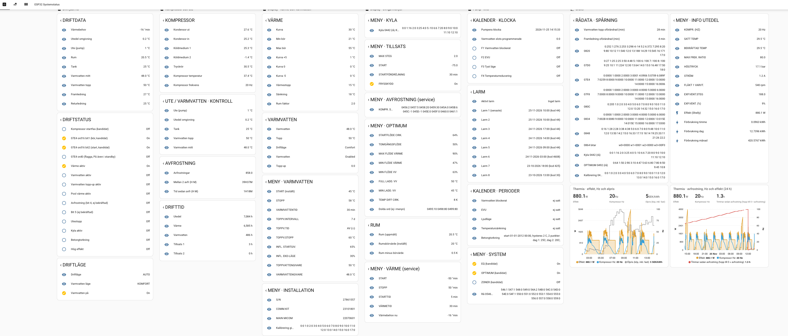
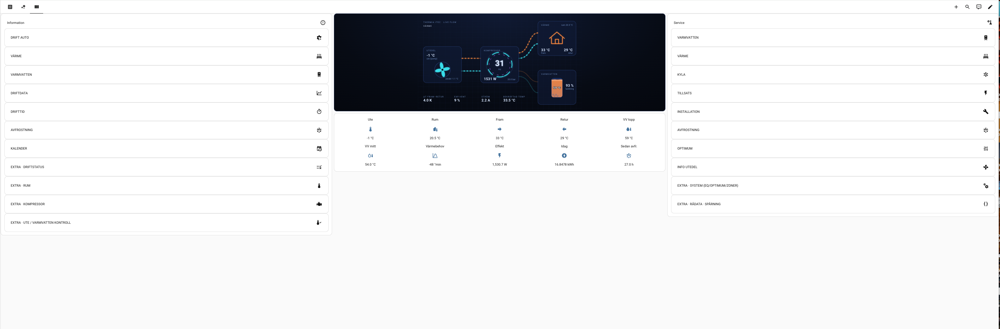

# Thermia iTec XT10: read-only DCM gateway emulation with ESPHome

[](https://www.paypal.me/peterssm)

A read-only emulation of the Thermia online gateway (DCM) for the **Thermia iTec XT10** air/water heat pump, running on an **ESP32-S3** with an RS485 transceiver and **ESPHome**. It lets Home Assistant read the heat pump's runtime values and menu settings locally, without the cloud and without writing anything to the pump.

> **Status: work in progress.** The ESP answers the pump's gateway handshake automatically after every pump start and then reads the pump continuously. Most sensors are verified against the pump display, and most settings were verified by changing the value on the display one step and watching which register moved. The rest are marked as candidates, see [docs/sensors.md](docs/sensors.md). The handshake code is not published yet.

New here? Start with [How it works, in plain words](docs/how-it-works.md).



## What it does

- Answers the pump's gateway challenge on slave address `0x0F` (RS485, 9600 baud, 8E1), automatically after each pump start, with no button press and no time limit.
- Acknowledges the 31 configuration pages the pump exports at start-up, the ten runtime pages that follow, any configuration page the pump re-sends after a setting change, and answers the `0708` mailbox. All acknowledgements are transport-level only.
- Decodes the received pages into Home Assistant sensors named like the pump's display menus (VARMVATTEN, VÄRME, TILLSATS, OPTIMUM, INFO UTEDEL, INSTALLATION, KALENDER and others).
- **Settings follow the display live.** When a value is changed on the pump display, the pump re-sends the configuration page and the ESP ACKs it (transport level only), so Home Assistant shows the new setting within seconds.
- Reports the ESP32-S3's own health (heap, PSRAM, Wi-Fi, uptime, bus and gateway state) for a "system status" view.

## What it does not do

- **No writes.** The ESP never changes a pump parameter. There are no setpoint sliders or room sensor writes, by design. Writing blind to a working heat pump can do real damage.
- No cloud, no account, no vendor app.

## Hardware

| Part | Notes |
|---|---|
| ESP32-S3 DevKitC-1 N16R8 | UART on GPIO17 (TX), GPIO18 (RX) |
| DollaTek 5 V MAX485 / RS485 module (TTL to RS-485) | DE/RE on GPIO21 |
| 3 x 4.7 kOhm resistors | voltage divider on RO, see below |
| Thermia iTec XT10 with Total EQ | display firmware CM930 2.4.0, COMM.KIT 2310 1801, MAIN MICOM 2207 601 |

### Wiring

| ESP32-S3 | RS485 module |
|---|---|
| GPIO17 (TX) | DI |
| GPIO18 (RX) | RO |
| GPIO21 | DE and RE (tied together) |

| Cable colour (RJ45 pin) | RS485 module terminal |
|---|---|
| brown (8) + white-brown (7), both conductors together | A |
| green (6) + white-blue (5), both conductors together | B |
| blue (4) + white-green (3), both conductors together | ground |

Each signal uses both conductors of its group in parallel. The pump ties these pins together internally (about 12 ohm between the two conductors of a group on my 20 m cable), so doubling them lowers the loop resistance.

> **Warning:** Pins 1 and 2 (white-orange and orange) of the pump's RJ45 port measured about 12 V in my installation. Do not connect them to the RS485 module or the ESP32. Insulate the unused wires at the module end so they cannot touch anything.

The module is powered from the 5 V pin of the ESP32-S3 board. Its RO output swings to 5 V, so it is level-shifted to the 3.3 V GPIO with a resistor divider made of the three 4.7 kOhm resistors:

```
RO --+-- 4.7k --+-- GPIO18
     +-- 4.7k --+      (two 4.7k in parallel = 2.35k)
                |
               4.7k
                |
               GND
```

This gives about 5 V x 4.7 / (2.35 + 4.7) = 3.3 V at GPIO18. DI and DE/RE are driven directly from the 3.3 V GPIOs, which the MAX485 accepts as a logic high.

Connect to the pump's gateway (DCM) RS485 port. Do not connect while the pump is running a service operation, and use it at your own risk.

## Getting started

1. Wire the ESP32-S3 and the RS485 module as above.
2. Flash the ESPHome firmware (the YAML will be added to this repository, see the roadmap).
3. Add the device to Home Assistant through the ESPHome integration.
4. **Restart the pump** about 30 seconds after the ESP has booted. The pump sends its gateway challenge only when the pump itself starts, and the ESP arms itself about 30 s after boot. The DCM symbol appears on the pump's main screen when the pump has accepted the gateway.
5. The pump then exports its 31 configuration pages (about 75 s) and the sensors fill in. After that the runtime pages arrive about every 21 s.


### Things to know

- The pump sends its gateway challenge only when the pump itself starts. After flashing or rebooting the ESP, the pump has to be restarted to start a new session. A pump restart while the ESP is off or not armed is lost.
- Restarting the pump resets the degree-minutes and stops the compressor. Plan firmware updates for a moment when no heating or hot water cycle is running.
- ESPHome allows one API client at a time, so stop any log script before flashing.
- If the session with the pump stops (for example after 5 failed gate checks in a row), the ESP has to be restarted and then the pump restarted again to re-establish it. Since v40c there is no automatic reboot. See [docs/troubleshooting.md](docs/troubleshooting.md).

## Home Assistant

The values in Home Assistant are checked against the pump's own display. The dashboard has expandable groups in the order of the pump's menus, an animated flow card, a card with power, compressor frequency and electricity price, and a card for defrost tracking. It uses the HACS cards `expander-card`, `mushroom` and `apexcharts-card`.



The flow card shows the heat pump, tank level, heating and hot water states, and an animated defrost view: the outdoor unit frosts over, icicles form and water drips while the pump sends warm refrigerant to the outdoor unit.


[Watch the flow card video](docs/images/flow-card.mov)

There is also an **ESP32 Systemstatus** view (memory, chip, network, bus and gateway state) built from the ESPHome debug component and a few extra template sensors.

Tip: if you rename entities, rename them in Home Assistant, not in the firmware. A new name in the firmware creates a new entity and leaves the old one orphaned.

The dashboard YAML, the flow card and the status view will be added under `homeassistant/`.

## Documentation

| Document | Contents |
|---|---|
| [docs/how-it-works.md](docs/how-it-works.md) | How it works, in plain words: start here if you are new |
| [docs/firmware.md](docs/firmware.md) | The firmware's building blocks: bus receiver, session and handshake, export, decoding, diagnostics |
| [docs/protocol-dcm.md](docs/protocol-dcm.md) | The DCM gateway protocol: challenge and handshake, export, runtime ring, mailbox, watchdog |
| [docs/registers.md](docs/registers.md) | Pages and words: what each register holds and how it was verified |
| [docs/sensors.md](docs/sensors.md) | Sensor list with status (verified / candidate / unknown) |
| [docs/defrost.md](docs/defrost.md) | The first captured defrost, with timestamps and words |
| [docs/alarms.md](docs/alarms.md) | Active alarm (`085F`), the alarm history (`0884`) compared with the display, and what is still unknown |
| [docs/FLOW_DIAGRAMS.md](docs/FLOW_DIAGRAMS.md) | Diagrams of the gateway: startup, session, runtime pages, receive gate, the alarm request and the status sensor |
| [docs/troubleshooting.md](docs/troubleshooting.md) | Resync, gate failures, lost sessions, what to do |
| [CHANGELOG.md](CHANGELOG.md) | Firmware history |

## Roadmap

- Publish the ESPHome YAML (without secrets) and the Home Assistant dashboard under `esphome/` and `homeassistant/`.
- Shorter sensor names with a substitution for device name and friendly name, so several pump models can be supported.
- Decode the remaining unknown words and flags (see [docs/sensors.md](docs/sensors.md)).
- Research towards writing to the pump (nothing is sent today). Nobody has published a confirmed write yet: a direct master write was reported as acknowledged but ignored, and gateway acknowledgements are transport-level only. If it becomes possible: a single harmless, reversible parameter first, with the owner present, read-back from the next configuration page, and an immediate revert on any deviation. No guessed frames.

## Safety

This is an independent hobby project and is not affiliated with Thermia. Use it at your own risk. It only reads, but it does connect a custom device to your pump's service bus.

## Support

This is a free hobby project, shared as it is. If it saved you time or helped you get your heat pump into Home Assistant, you are welcome to support the work:

[](https://www.paypal.me/peterssm)

## Credits

- [ryckema/Thermia_itec](https://github.com/ryckema/Thermia_itec) for the iTec protocol work this builds on, and for the forum discussion that cross-checked several registers (`0864` word 1 status bits, `0553` operating mode, `0848` heat demand, the immersion heater bits).
- [fclauson/Thermia-ATEC-ESP-emulator-of-DCOM](https://github.com/fclauson/Thermia-ATEC-ESP-emulator-of-DCOM) for the CM930 handshake calculation that the challenge response in this firmware is derived from (MIT license).
- [piotr-romanowski/thermia-bus-sniffer](https://github.com/piotr-romanowski/thermia-bus-sniffer) for the passive bus notes.
- The Home Assistant community thread on local Thermia iTec integration.

## License

MIT, see [LICENSE](LICENSE). The handshake calculation is derived from MIT-licensed code by Francis Clauson, see [NOTICE.md](NOTICE.md).
