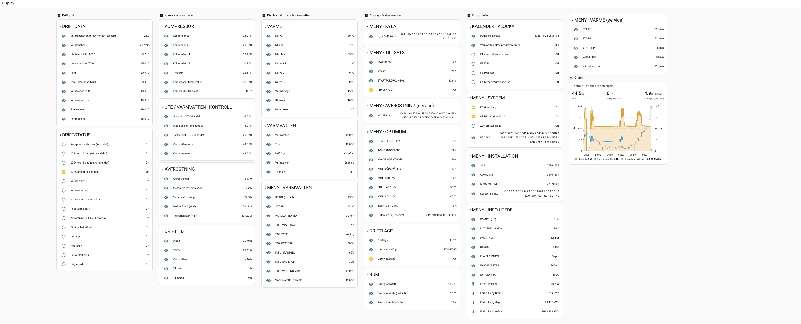

# Thermia iTec XT10: read-only DCM gateway emulation with ESPHome

A read-only emulation of the Thermia online gateway (DCM) for the **Thermia iTec XT10** air/water heat pump, running on an **ESP32-S3** with an RS485 transceiver and **ESPHome**. It lets Home Assistant read the heat pump's runtime values and menu settings locally, without the cloud and without writing anything to the pump.

> **Status: work in progress.** The ESP answers the pump's gateway handshake automatically after every pump start and then reads the pump for hours at a time. Most sensors are verified against the pump display, most settings were verified by changing the value on the display one step and watching which register moved. The rest are marked as candidates (see below). The handshake code is not published yet.

## Current status (24 November 2026, evening)

- The ESP arms itself about 30 s after boot, with no button and no time limit. If the session with the pump is lost for 90 s, a watchdog reboots the ESP. The watchdog has been exercised twice (see below).
- Start-up: 31 of 31 configuration pages are ACKed within about 75 s of the pump's challenge, then the runtime ring of ten pages (about every 21 s) plus the `0708` mailbox. The current firmware (v37) has run since 17:16 without errors, CRC failures or dropped frames.
- **Settings follow the display live.** When a value is changed on the pump display, the pump re-sends the configuration page (for example `03E8`, 14 words) and expects an ACK. The firmware now ACKs it (transport level only), stores the new words and logs the raw page, so Home Assistant shows the new setting within seconds. Tested with room setpoint, high power, hot water, heating and TILLSATS settings.
- Two session losses today, both fixed:
  - An isolation gate that was too strict ended the session when 5 stray bytes appeared on the bus in one runtime page. Since v36 a failed gate only skips that ACK (the pump retries the page) and the session stops only after 5 failures in a row.
  - An unrecognised page (a re-sent configuration page after a setting change) ended the session. Since v37 such pages are recognised by address and length and ACKed.
- Heating cycle observed from start: start phase (`0864` word 2 bit 0, 64 s and 127 s in two runs), then heating active when the start phase ends. Heat demand jumps from about -50 to -15 degree-minutes at compressor start. The natural stop has not been captured yet in this firmware.
- Still open: defrost flags, top-up (legionella) flag, immersion heater bits, a few unknown menu words (see below).

## What it does

- Answers the pump's gateway challenge on slave address `0x0F` (RS485, 9600 baud, 8E1), automatically after each pump start, with no button press and no time limit.
- Acknowledges the 31 configuration pages the pump exports at start-up, the ten runtime pages that follow, any configuration page the pump re-sends after a setting change, and answers the `0708` mailbox. All acknowledgements are transport-level only.
- Decodes the received pages into Home Assistant sensors named like the pump's display menus (VARMVATTEN, VÄRME, TILLSATS, OPTIMUM, INFO UTEDEL, INSTALLATION, KALENDER and others).
- Includes read-only timers (hot water charge duration and count, time since compressor start).

## What it does not do

- **No writes.** The ESP never changes a pump parameter. There are no setpoint sliders or room sensor writes, by design. Writing blind to a working heat pump can do real damage.
- No cloud, no account, no vendor app.

## Known behaviour

- The pump sends its gateway challenge only when the pump itself starts. After flashing or rebooting the ESP, the pump has to be restarted to start a new session.
- Restarting the pump resets the degree-minutes and stops the compressor. Plan firmware updates for a moment when no heating or hot water cycle is running.
- ESPHome allows one API client at a time, so stop any log script before flashing.

## Hardware

| Part | Notes |
|---|---|
| ESP32-S3 DevKitC-1 N16R8 | UART on GPIO17 (TX), GPIO18 (RX) |
| DollaTek 5 V MAX485 / RS485 module (TTL to RS-485) | DE/RE on GPIO21 |
| 3 x 4.7 kOhm resistors | voltage divider on RO, see Wiring |
| Thermia iTec XT10 with Total EQ | display firmware CM930 2.4.0, COMM.KIT 2310 1801, MAIN MICOM 2207 601 |

### Wiring

| ESP32-S3 | RS485 module |
|---|---|
| GPIO17 (TX) | DI |
| GPIO18 (RX) | RO |
| GPIO21 | DE and RE (tied together) |

| Cable colour | RS485 module terminal |
|---|---|
| brown | A |
| green | B |
| blue | ground |

The module is powered from the 5 V pin of the ESP32-S3 board. Its RO output swings to 5 V, so it is level-shifted to the 3.3 V GPIO with a resistor divider made of the three 4.7 kOhm resistors:

```
RO --+-- 4.7k --+-- GPIO18
     +-- 4.7k --+      (two 4.7k in parallel = 2.35k)
                |
               4.7k
                |
               GND
```

This gives about 5 V x 4.7 / (2.35 + 4.7) = 3.3 V at GPIO18. DI and DE/RE are driven directly from the 3.3 V GPIOs, which the MAX485 accepts as a logic high.

Connect to the pump's gateway (DCM) RS485 port. Do not connect while the pump is running a service operation, and use it at your own risk.

## Verified against the pump display

"Changed" means the value was changed one step on the display, the register was seen to follow, and the value was changed back.

### Settings (configuration pages)

| Display menu / value | Register | How verified |
|---|---|---|
| Heating curve (KURVA), MIN BÖR, MAX BÖR, KURVA +5 / 0 / -5, VÄRMESTOPP, SÄNKNINGSTEMP, RUM FAKTOR | `03E8` to `03F0`, in menu order | matched to display values |
| Room setpoint | `03F4` (whole degrees C) | changed |
| HÖG EFFEKT (on/off) | `03F3` (0/1) | changed |
| Operating mode (off, auto, compressor, additional heat, hot water) | `0553` | matched |
| VARMVATTEN: START, STOPP | `041D`, `0424` | matched / changed |
| VARMVATTEN: VARMVATTENTID, TOPPV.INTERVALL, TOPPV.STOPP | `041E`, `041F`, `0421` | changed |
| VARMVATTEN: INFL. STARTGIV. (stored /5) | `0422` | changed |
| VÄRME (service): START / STOPP in degree-minutes (displayed = -5 x stored) | `0431`, `0432` | changed |
| VÄRME (service): STARTTID, VÄRMETID | `0433`, `0434` | changed |
| TILLSATS: MAX STEG | `0456` | changed |
| TILLSATS: START (displayed = -15 x stored, so -75 is stored as 5) | `0457` | changed (three points: -75, -60, -90) |
| TILLSATS: STARTFÖRDRÖJNING | `0459` | changed |
| TILLSATS: FRYSSKYDD (0/1) | `0461` | changed |
| OPTIMUM flows, charge temperatures, circulation | `0492` to `049C` | matched |

### Runtime values

| Display menu / value | Where it comes from | Verified |
|---|---|---|
| INFO UTEDEL: compressor Hz, max frequency ratio, current, fan rpm | page `0820` | yes |
| INFO UTEDEL: high pressure (word 16, /10 bar), expansion valve steps (word 13) and percent (steps / 20) | page `0820` | yes (standby: 7.1 bar, 2000 steps = 100 %; running: 17.4 bar, 189 steps = 9 %) |
| INFO UTEDEL: BEKRÄFTAD TEMP | page `0820` word 7 (/10) | yes |
| INFO UTEDEL: SATT TEMP | derived: word 7 while the compressor runs, otherwise 0 | yes (before start, running, stopped) |
| Heat demand in degree-minutes | page `0848` word 0 (sign inverted) | yes |
| Setpoint in brackets after TANK on DRIFTDATA, for example "TANK 26 (29)" | page `0848` words 1 and 2 | likely (one reading) |
| Heating active, hot water active | `0864` word 1 bit 0 / bit 1 | yes (live) |
| Compressor start phase | `0864` word 2 bit 0 | yes (live) |
| Compressor start / running | `07E4` word 16 bit 2 / bit 1 | yes (live) |
| Hot water temperature (top) | page `07D0` | yes |
| Pump clock | page `0848` words 16 to 22 | yes |
| Serial number, COMM.KIT and MAIN MICOM versions | `06F2/06F3`, `07E4` | yes |
| Operating hours, defrost count and intervals | page `0870` | yes |

## Candidates and open items

- Defrost: `0864` word 1 bits 4 and 5 (defrost using building heat / hot water heat) and `0820` word 15 (`082F`) bit 2. Never seen set yet, there has been no defrost since logging started.
- Top-up (legionella) flag: `0864` word 1 bit 2. Never seen set yet. Interval is 7 days, stop temperature 60 C.
- Immersion heater status: `07D0` words 13 and 14 (`07DD` mask 0x80, `07DE` masks 0x10 and 0x08), taken from a forum report. Not yet seen active.
- Unknown menu words in the `03E8` page: `03F1` = 40, `03F2` = 30, `03F5` = 2. In the TILLSATS page: `0458` = 20, `045B` = 6.
- Setpoint words 1 and 2 of page `0848` (both 29 at the same time), tank setpoint (likely).
- EQ / OPTIMUM / ZONER flags (`0546`), and a second block starting at `03FC` that looks like another heating circuit.

## Roadmap

Done in v37: log the raw content of configuration pages that the pump re-sends outside the start-up export, ACK them transport-only, and update the cached values so the sensors follow the display.

Next firmware step (v38, read-only, ready): candidate sensors for `082F` bit 2, the three immersion heater bits and raw words `03F1`, `03F2`, `03F5`.

Towards writing to the pump (research, not implemented, nothing is sent today):
- Capture how a change made on the pump display is reported to the gateway (frame, timing, value), then how a real gateway reports a change in the other direction. Nobody has published a confirmed write yet: a direct master write was reported as acknowledged but ignored, and gateway acknowledgements are transport-level only.
- If it becomes possible: a single harmless, reversible parameter first, with the owner present, read-back from the next configuration page, and an immediate revert on any deviation. No guessed frames.

## Home Assistant

The repository will include a dashboard with expandable groups in the order of the pump's menus, an animated flow card (heat pump, tank level, heating and hot water states), a card with power, compressor frequency and electricity price, and a card for defrost tracking. The expandable dashboard uses the HACS cards `expander-card` and `mushroom`.

Tip: if you rename entities, rename them in Home Assistant, not in the firmware. A new name in the firmware creates a new entity and leaves the old one orphaned.



## Safety

This is an independent hobby project and is not affiliated with Thermia. Use it at your own risk. It only reads, but it does connect a custom device to your pump's service bus.

## Credits

- [ryckema/Thermia_itec](https://github.com/ryckema/Thermia_itec) for the iTec protocol work this builds on, and for the forum discussion that cross-checked several registers (`0864` word 1 status bits, `0553` operating mode, `0848` heat demand, the immersion heater bits).
- [piotr-romanowski/thermia-bus-sniffer](https://github.com/piotr-romanowski/thermia-bus-sniffer) for the passive bus notes.
- The Home Assistant community thread on local Thermia iTec integration.

## License

To be decided before the code is published.
