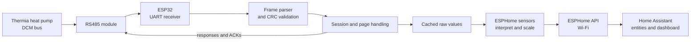
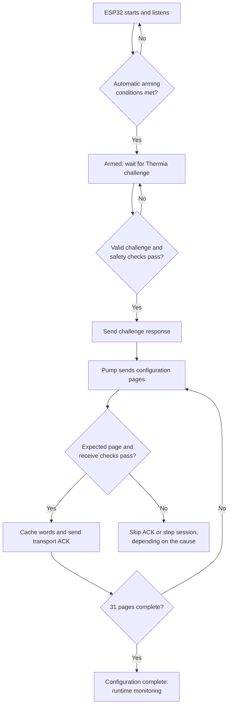
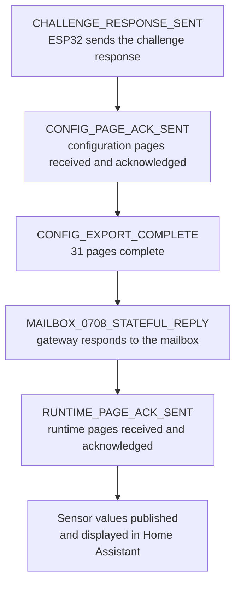
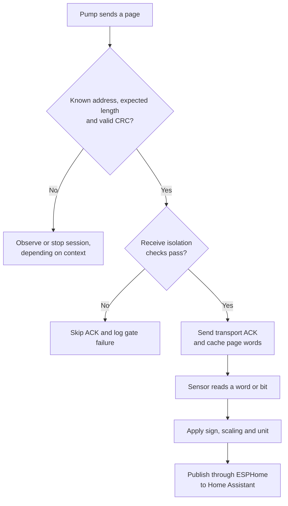
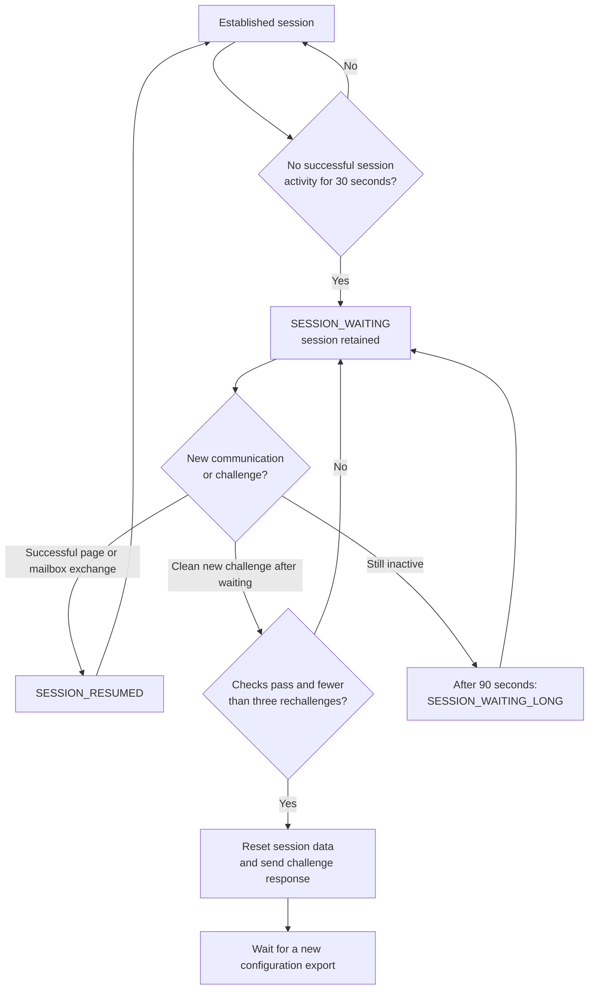
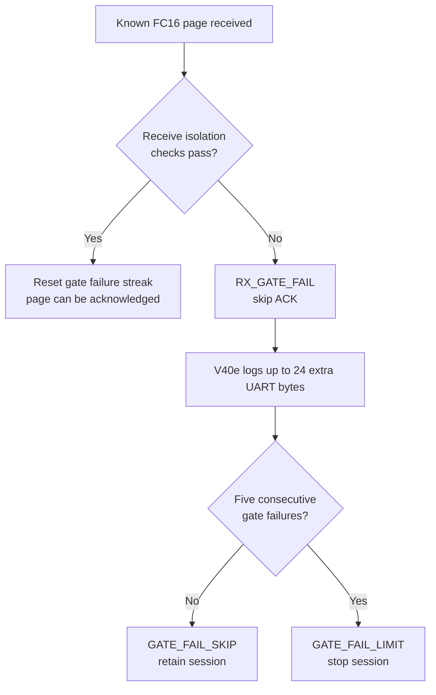

# Thermia iTec DCM gateway – firmware flows in V40e

This guide explains how the V40e ESPHome gateway receives information from a Thermia heat pump and exposes it in Home Assistant. The diagrams are simplified descriptions of this firmware, not an official Thermia protocol specification.

## From heat pump to Home Assistant

The ESP32 receives pump data and sends protocol responses on the bus. V40e does not write heat pump settings. An ACK is a transport acknowledgement; it does not change a setpoint.

## Startup and configuration

Automatic arming requires sufficient observed bus traffic and no blocking condition in the gateway's safety checks. The pump must then send a challenge. If the ESP32 restarts while the pump is already running, the pump may need a restart to issue a new challenge.

The 31 expected configuration pages contain heating and hot water settings, advanced menus and calendar data. During a session the pump can also resend a known configuration page; when the checks pass, the cached values are updated.

## Follow the DCM connection in the log

`CHALLENGE_RESPONSE_SENT` shows that the ESP32 sent its response. Completion of the configuration export followed by ongoing runtime data provides stronger evidence that the DCM session is working. This diagram shows the main sequence; other log entries and pages can appear between the steps.

## Runtime pages and sensors

Examples include `07D0` for hydraulic temperatures, `080C` for room temperature, `0820` for outdoor unit data, `0848` for values including heat demand, `0870` for operating hours and defrost information, and `0884` for alarm history. Some fields remain candidates and need comparison with the pump display.

The `0708` mailbox is used to respond to controller polls. The gateway also requests page `0820` for selected sensor monitoring approximately 60 seconds after the preceding request cycle completes. Other known runtime pages are received and acknowledged when the pump sends them.

Many runtime sensors become unavailable if their page has not been updated for five minutes. Configuration values can remain visible after their initial read; the configuration data age sensor shows how old the cached page is.

## Inactivity and a new challenge

During inactivity V40e retains the session. If a new challenge passes the checks, several session fields are reset and cached sensor data is marked for a fresh read. Up to three rechallenges are allowed per ESP32 boot. Other protection conditions can stop the session, in which case this recovery path does not automatically rearm it.

The rechallenge path has been exercised in a host test with simulated traffic. Recovery after a real heat pump restart still needs verification on the installation. A challenge arriving before the waiting state is active is not answered by the rechallenge rule.

## Receive gate and diagnostics

Before an FC16 response, the gateway checks for conditions including additional frames, incomplete parser data and bytes waiting in UART. V40e reads the extra UART bytes that it logs. This can consume bytes that might otherwise form part of a later frame and should be considered when interpreting the log. The mailbox has separate gate handling.

| Log or sensor | Meaning |
| --- | --- |
| `CONFIG_EXPORT_COMPLETE` | The 31 configuration pages have been processed. |
| `RUNTIME_PAGE_ACK_SENT` | A transport ACK was sent for a known runtime page. |
| `STATUS` | Session state, page counts and pending requests. |
| `RX_GATE_FAIL` / `GATE_EXTRA_BYTES` | Why an FC16 ACK was skipped and any extra captured UART bytes. |
| `SESSION_WAITING` / `SESSION_WAITING_LONG` | No successful session activity for approximately 30 or 90 seconds. |
| `RECHALLENGE_RESPONSE_SENT` | A response to a new challenge was sent; check that configuration export follows. |
| `DCM RX dropped frames` | The parser's counter for certain buffer overflows; it does not count all possible missed messages. |
| `Resync Share` | Parser resynchronization steps divided by valid frames. It is not a percentage of missed readings. |

## Alarms and current limits

Page `085F` still has a limit of 16 alarm ACKs per ESP32 boot, plus a one-time exception for an identical repeat. After the limit is reached, repeated offers of the page can be left without an ACK. Check the age of the last alarm observation: an old value does not prove the current alarm state.

Alarm history comes from `0884`. Calendar text displays the first period of each calendar. Some fields and time formats remain under verification against the pump menus.

The Wi-Fi configuration can restart the ESP32 after 30 minutes without a connection. After an ESP32 restart, the gateway may need a new challenge from the pump before receiving data again.
