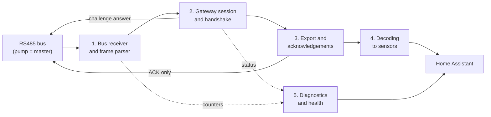
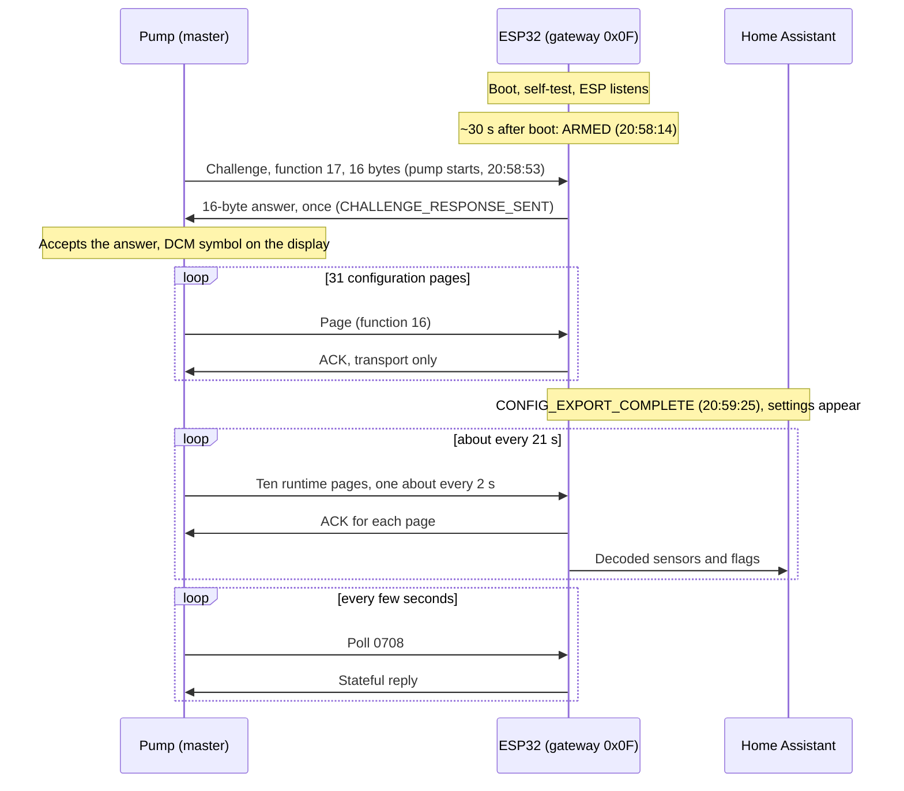

# Firmware building blocks

The firmware (ESPHome, ESP32-S3 + MAX485) is one YAML file with a C++ lambda core. It has four main blocks and one supporting block. Nothing in it writes to the pump: every transmission is a transport-level acknowledgement or the handshake answer.

## 1. Bus receiver and frame parser

Reads the RS485 line (9600 baud, 8E1) and assembles Modbus RTU frames.

- Checks the CRC of every frame and resynchronises on a frame header when the stream is out of step (about 6-10 % of frames here, normal).
- Counts dropped and ambiguous frames.
- Holds the **isolation gate**: a runtime page is acknowledged only if it arrived alone, with nothing else pending in the UART. A page that fails the gate is not acknowledged, and nothing is ever acknowledged because of what else was on the line.

Log lines: `RESYNC`, `RX_GATE_FAIL`, `GATE_FAIL_SKIP`, `GATE_EXTRA_BYTES` (v40e), `GATE_FAIL_LIMIT_REACHED` and `KNOWN_EXTRA_FRAME_SEEN` (v41f). See [troubleshooting.md](troubleshooting.md).

## 2. Gateway session and handshake

Makes the pump accept the ESP as its gateway and keeps the session alive.

- Detects the pump's challenge (function 17) and calculates the answer. The calculation is checked against a known test vector at every boot.
- Arms itself about 30 s after boot. It answers once per boot, plus a limited re-challenge after a pump restart (candidate in v40c to v40e).
- Session rules: up to v41e the session stopped after 5 failed gates in a row. From v41f it stays armed and the status shows `Gate-fel pågår` until a clean page arrives. It reports waiting after 30 s without valid traffic (`SESSION_WAITING`), resume when clean traffic returns.

Log lines: `ARMED`, `CHALLENGE_RESPONSE_SENT`, `SESSION_WAITING`, `RECHALLENGE_ACCEPTED`, `CHALLENGE_NOT_ANSWERED`, `GATE_FAIL_LIMIT` (up to v41e). See [protocol-dcm.md](protocol-dcm.md).

## 3. Export and acknowledgements

Takes in what the pump sends once the session is open and acknowledges it, transport only.

- The configuration export (31 pages, about 75 s after the challenge).
- The runtime ring (10 pages, a full cycle about every 21 s) which carries all live values.
- The mailbox poll (`0708`, every few seconds) with its stateful reply, the alarm page `085F`, and configuration pages the pump re-sends after a change on the display.

Log lines: `CONFIG_EXPORT_COMPLETE`, `RUNTIME_PAGE_ACK_SENT`, `MAILBOX_0708_STATEFUL_REPLY`. From v41 the alarm page has its own scheduler and log lines (`ALARM_085F_REQUEST_START`, `ALARM_085F_REQUEST_TIMEOUT`, `ALARM_085F_WORDS`); see [alarms.md](alarms.md). See [registers.md](registers.md).

## 4. Decoding to sensors

Stores the words of each page and turns them into Home Assistant entities.

- Numeric sensors with scaling (for example tenths of a degree), temperatures, pressures, frequencies, counters and settings.
- Binary flags from bits (for example defrost in `0864` word 1 bit 4 and `082F` bit 2) and text sensors (alarms, calendars, versions).
- Derived values, such as SATT TEMP, and sign changes so the value matches the display (degree-minutes).

Status of every sensor (verified, candidate, never seen, unknown): [sensors.md](sensors.md). Defrost example: [defrost.md](defrost.md).

## 5. Diagnostics and health (supporting)

Not read from the pump.

- ESP32 status: heap, largest free block, minimum free, PSRAM, loop time, uptime, reset reason, chip temperature, Wi-Fi.
- Gateway health: bus OK, armed, time since last frame, frames seen, resync share, counters of pages and ACKs.
- The event log used for fault finding. A read-only capability report for other pump models is planned.

## Step by step: from a pump start to sensors in Home Assistant

What happens as soon as the pump sends. Times are from a real restart on 25 November 2026 (local time).

1. **Self-test and listening.** The ESP checks its handshake calculation against a test vector and starts reading the bus.
2. **Armed.** About 30 s after boot the log shows `ARMED`. A pump start before this is missed.
3. **Challenge.** Only when the pump itself starts does it send the challenge.
4. **Answer.** If exactly one clean frame arrived and nobody else is talking, the ESP answers once. The pump shows the DCM symbol when it accepts.
5. **Configuration export.** 31 pages, each ACKed and stored (32 s in this run, up to about 75 s).
6. **Runtime ring and mailbox.** Ten pages per cycle, each ACKed, plus the `0708` poll. All live values come from here.
7. **Decode and publish.** Pages become sensors in Home Assistant, and every page passes the isolation gate before it is ACKed.

## Versions

What changed in each firmware version: [../CHANGELOG.md](../CHANGELOG.md).
